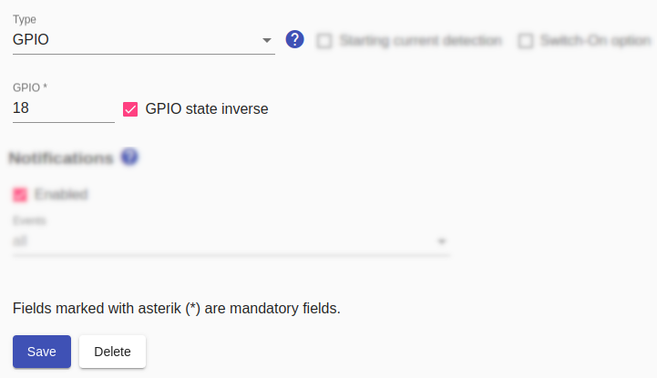
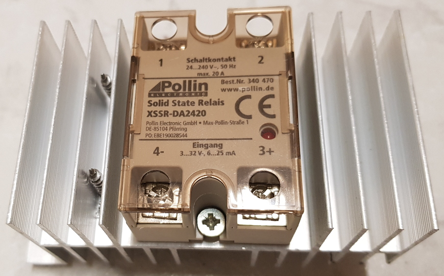
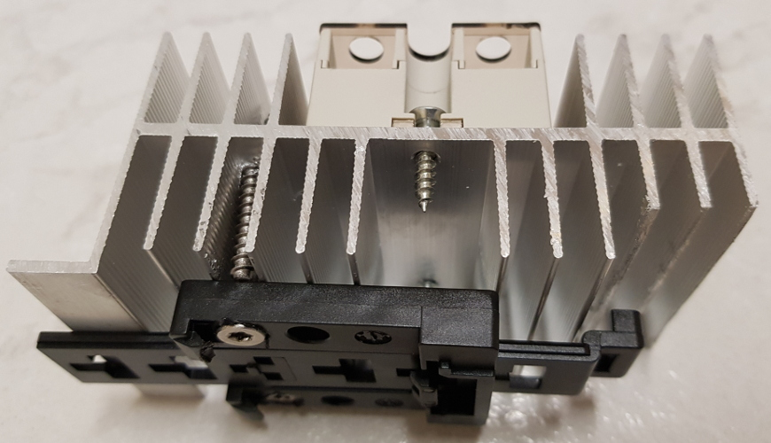
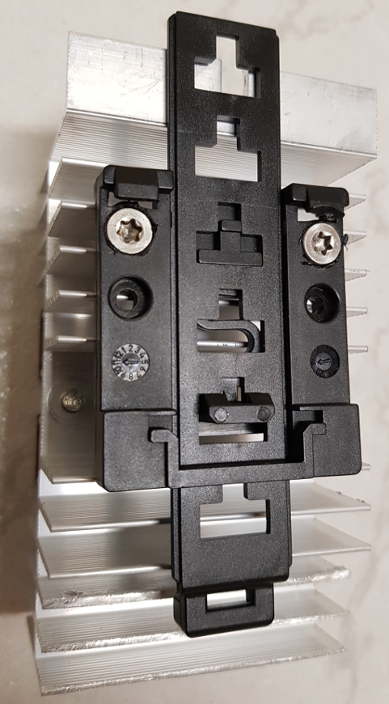
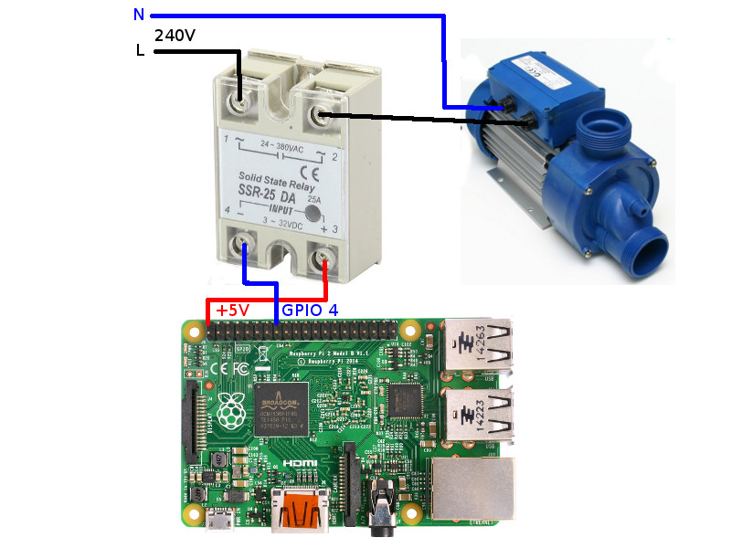

# GPIO switches
The Raspberry Pi has **GPIO ports** that can be turned on and off.
The [Notes on the Raspberry Pi and the numbering of the GPIO ports](Raspberry_EN.md) should be observed!

Configuring a GPIO switch involves specifying the GPIO port number and whether to invert the switch state.



## Log
If a device (in this case, `F-00000001-000000000001-00`) is toggled via a GPIO-based switch, the switching command can be viewed in the [log](Logging_DE.md) using the following command:

```bash
$ grep "c.Switch" /tmp/rolling-2026-11-07.log | grep F-00000001-000000000001-00
2026-11-07 07:39:33,658 INFO [MQTT Call: F-00000001-000000000001-00-Switch-1] d.a.s.c.Switch [Switch.java:153] F-00000001-000000000001-00: Switching on GPIO 21
```

*Webmin*: In [View Logfile](Logging_DE.md#user-content-webmin-logs), enter `c.Switch` in the field labeled `Only show lines with text` and click Refresh.

The status of the corresponding GPIO pin can be checked as follows:

```shell
$ pinctrl get 21
21: op -- pn | hi // GPIO21 = output
```

## Solid state relais

[**Solid State Relays**](https://de.wikipedia.org/wiki/Relais#Solid State Relays) are suitable for switching 230V devices.

Originally I had bought several SSRs from Fotek, type SSR-40 DA, two of them (dishwasher and washing machine) I had to replace after 3 years after they had burned out. These SSRs have a metal plate on the back that allows you to mount them on a heatsink, which I didn't do. Some of the SSRs I bought were defective from the start and after the two SSRs recently burned through, I did some research. [There seem to be counterfeits in circulation](https://www.mikrocontroller.net/topic/444199) of the Fotek SSRs, which can only cope with lower currents than specified.

For this reason I have bought several [XSSR-DA2420 from the German electronics retailer Pollin](https://www.pollin.de/p/solid-state-relais-xssr-da2420-3-32-v-20-a- 240-v-340470) who has them produced and labeled for himself. Accordingly, I hope that it is a product whose quality corresponds to the specified specification.

To minimize the risk of overheating, I immediately [ordered suitable heat sinks from Pollin](https://www.pollin.de/p/strangkuehlkoerper-kab-60-125-50-430152). Regarding the assembly, I started to ponder how to attach the heatsink to the **Bopla TSH 35** type DIN rail mount mentioned above. In the end I did it as shown in the photos, although I had to shorten three cooling fins a bit.


<br>SSR with heatsink


<br>SSR with heatsink on DIN rail holder from the side


<br>SSR with heatsink on DIN rail holder from rear

[Pohltechnik](https://www.pohltechnik.com/de/ssr-relais) also has suitable SSRs and suitable heat sinks.

#### Wiring example: Switching a 240V device using a solid-state relay
The wiring for switching a 240V device (e.g. pump) using a solid-state relay could look like this:


